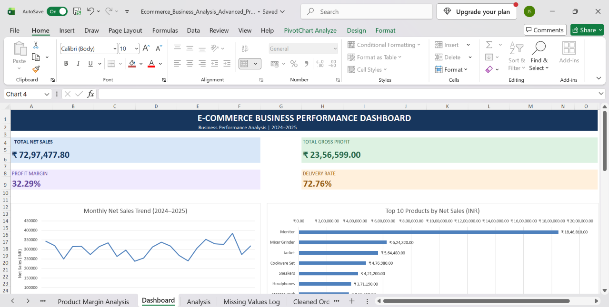
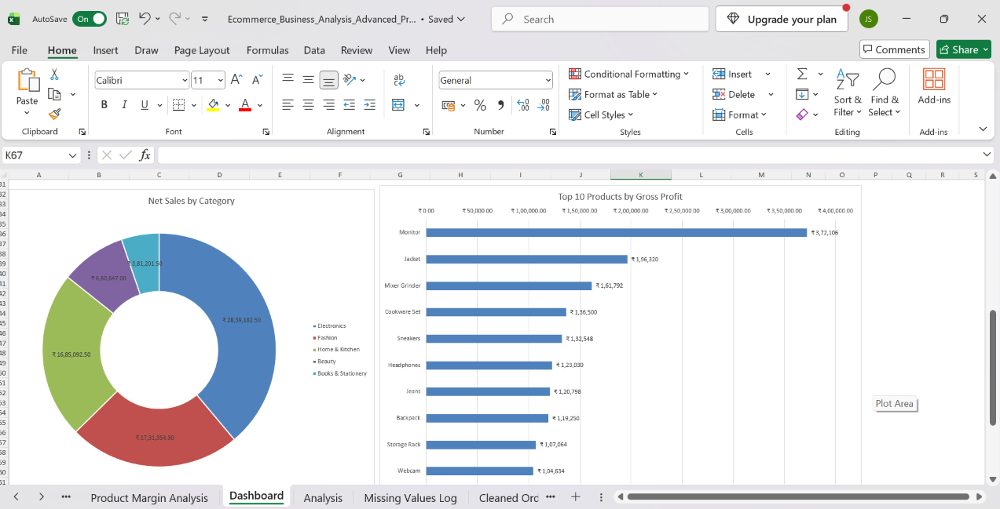
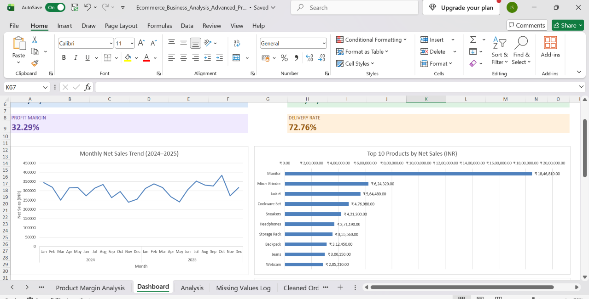

# 📊 E-Commerce Business Performance Analysis

An Excel-based business analysis project exploring e-commerce sales, product performance, profitability, order status, and monthly sales trends for 2024–2025.

## 🖥️ Dashboard Preview

### 1. Business Performance Dashboard

### 2. Category and Profitability Analysis

### 3. Monthly Sales and Product Analysis

---

## 📌 Key Performance Indicators

| Metric | Result |
|---|---:|
| Total Recorded Net Sales | ₹72,97,477.80 |
| Total Recorded Gross Profit | ₹23,56,599.00 |
| Overall Profit Margin | 32.29% |
| Delivery Rate | 72.76% |
| Return Rate | 17.52% |

## 🔍 Key Business Insights

- **Sales Growth:** Recorded net sales increased by approximately 7.04% from 2024 to 2025.
- **Top Category:** Electronics contributed approximately 38.9% of recorded net sales.
- **Top Profit-Generating Product:** Monitor generated ₹3,72,106 in gross profit.
- **Returns:** The recorded return rate was 17.52%, highlighting an area for further investigation.

## 🛠️ Tools and Skills

- Microsoft Excel
- Power Query for data cleaning and transformation
- Excel formulas and XLOOKUP
- PivotTables and PivotCharts
- KPI dashboard development
- Data visualization and business analysis

## 📁 Project Workbook

**File:** `Ecommerce_Business_Analysis_Advanced_Practice.xlsx`

Download the Excel workbook from the file list above to explore the data, calculations, PivotTables, and dashboard.

## 📝 Dataset Note

This project uses a practice dataset. Sales and profit metrics include orders with different statuses and should be interpreted as recorded figures rather than confirmed realized revenue.

## 🎯 Project Objective

To demonstrate practical Excel data analysis skills by transforming raw e-commerce data into meaningful business metrics, visualizations, and actionable insights.
